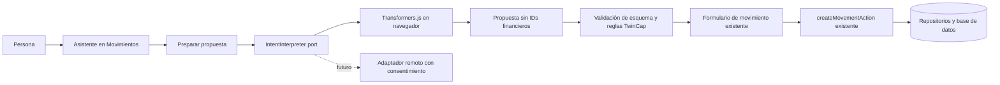

# Diseño base: asistente conversacional para preparar operaciones

> **Estado:** laboratorio Transformers.js probado en Redmi 15 sin latencia aceptable; spike Gemini server-side. Una llamada inicial funcionó antes de enviar categorías; las posteriores devolvieron HTTP 503 por indisponibilidad temporal, así que se añadió un reintento acotado. TwinCap normaliza fecha, categoría y campos pendientes. La evaluación en vivo del catálogo y la integración para usuarios siguen pendientes.
> **Origen/fecha:** solicitud del fundador, 2026-11-08.
> **Relación con MCP:** capacidad distinta. MCP conecta agentes externos con TwinCap; este diseño incorpora una experiencia de conversación dentro de TwinCap.

## 1. Objetivo

Permitir que una persona describa una operación financiera en lenguaje natural y que TwinCap prepare el formulario correspondiente para revisión y envío explícito por esa persona.

Ejemplo: “Gasté 10 mil en gasolina de la moto” puede proponer un gasto por 10.000, con fecha de hoy y categoría sugerida “Moto” si existe entre las categorías disponibles. El contexto queda sin seleccionar mientras la frase o el flujo no lo establezcan claramente. TwinCap no debe asumir silenciosamente cuenta ni moneda.

## 2. Alcance de la primera prueba

- Interfaz dentro de TwinCap, iniciada desde Movimientos.
- Solo captura de texto y solo preparación de un gasto Personal.
- Comparar inferencia local en navegador con Transformers.js y un proveedor API detrás del
  mismo puerto `IntentInterpreter`; la primera evaluación remota usa Gemini solo en desarrollo.
- La conversación genera una propuesta estructurada, no ejecuta herramientas ni operaciones financieras.
- TwinCap abre el formulario existente con los campos propuestos. La persona puede corregir cualquier dato y debe enviar el formulario de la manera habitual.
- Cuenta, moneda y contexto permanecen bajo control de TwinCap. Si no hay un contexto explícito heredado del formulario, la propuesta mantiene contexto vacío y `missingFields` incluye `context`; no se deduce de la frase, la categoría ni el historial. La persona lo elige en el formulario antes de enviar. La moneda de una operación de una sola cuenta siempre deriva de la cuenta seleccionada.
- Si no se menciona fecha, TwinCap propone la fecha civil de hoy con su helper de zona horaria. El modelo solo interpreta fechas mencionadas; no decide el valor por defecto.
- Si falta un dato requerido o hay ambigüedad financiera, la interfaz pregunta antes de mostrar el borrador como listo.
- Si el modelo no está disponible, se cancela, falla o tarda demasiado, el formulario manual sigue disponible.

Fuera de esta prueba: ingresos, transferencias, créditos, ventas, inventario, escritura automática, audio y sincronización de conversaciones. El spike API de Gemini queda restringido a frases sintéticas predefinidas y no se ofrece a usuarios.

## 3. Límites de confianza

1. La salida del modelo es entrada no confiable, aunque el proveedor la describa como JSON estructurado.
2. El modelo no recibe ni emite `userId`, `workspaceId`, `accountId`, `categoryId`, claves de idempotencia, balances o credenciales.
3. La propuesta solo contiene datos que puedan mostrarse en un formulario. El navegador valida su forma y el backend conserva sus validaciones actuales como autoridad final.
4. El módulo de IA no importa ni llama Server Actions de escritura. El único camino para persistir sigue siendo el formulario y `createMovementAction` existentes.
5. La confirmación es una acción clara de la persona en TwinCap; una respuesta afirmativa dentro del chat no guarda nada por sí sola.
6. No se persiste historial de conversación en el servidor durante el piloto. El texto vive en memoria de la pantalla hasta que esta se cierre. La caché del modelo no debe incluir mensajes ni datos financieros.
7. Un proveedor remoto futuro requiere consentimiento separado, información de qué contenido sale del dispositivo y una política explícita de retención. Nunca se reutiliza el consentimiento de MCP.

## 4. Arquitectura



### Capas y ubicación propuesta

- `core/domain/assistant/`: tipos neutrales de propuesta e invariantes puras; sin Next.js, navegador, modelos ni proveedores.
- `core/application/assistant/`: caso de uso `prepare-movement-draft` y puerto `IntentInterpreter`.
- `infrastructure/ai/browser/`: adaptador cliente de Transformers.js, carga diferida del modelo, worker y normalización de la respuesta del runtime.
- `infrastructure/ai/remote/` (futuro): adaptadores de APIs remotas; nunca importar en el bundle del cliente.
- `components/assistant/`: pantalla conversacional, estado de carga/progreso, aclaraciones y resumen editable.
- `app/(main)/movements/`: obtiene los datos existentes de cuenta/categoría y conecta la propuesta al formulario normal.

Las dependencias de `core` no conocen los adaptadores. No se crea un framework de agentes ni un registro extensible por plugins para la primera fase. El selector de proveedor se mantiene como una configuración explícita de TwinCap; cada adaptador implementa el mismo puerto.

## 5. Contrato común de propuesta

El contrato versión 1 está limitado a campos declarativos y no ejecutables:

```ts
type MovementDraftProposalV1 = {
  schemaVersion: 1;
  intent: "create_movement" | "unsupported";
  type: "expense" | "income" | null;
  amountText: string | null;
  note: string | null;
  date: string | null;
  categoryHint: string | null;
  missingFields: Array<"type" | "amount" | "account" | "category" | "context" | "date">;
  clarification: string | null;
};
```

- `amountText` representa un decimal canónico en unidades mayores, como cadena, sin moneda ni símbolo; evita introducir redondeo binario en el paso de extracción. Solo después de seleccionar la cuenta, el formulario aplica el exponente de su moneda y las utilidades monetarias actuales producen unidades menores enteras. Rechazar negativos, formato fuera de rango o importe ambiguo; no inferir moneda desde la frase.
- `date` es una fecha civil `YYYY-MM-DD`, no un instante con zona horaria. Si no se menciona fecha, TwinCap propone “hoy” con su helper de fecha civil; fechas futuras siguen bloqueadas por la regla actual.
- Antes de interpretar, el proveedor recibe el catálogo permitido de categorías de gasto del workspace, con etiquetas pero sin IDs. En proveedores remotos, compartir esas etiquetas requiere informar y obtener el consentimiento correspondiente; el laboratorio Gemini solo usa categorías sintéticas.
- `categoryHint` es una sugerencia textual elegida del catálogo: por ejemplo, “gasolina de la moto” puede sugerir “Moto”. TwinCap la empareja solo contra categorías disponibles del tipo y contexto elegido; si no hay coincidencia única, deja la categoría sin resolver para elección manual. El modelo nunca inventa el ID. No se infiere contexto a partir de la categoría. Si el contexto sigue vacío, el formulario valida la sugerencia contra las categorías del contexto elegido antes de preseleccionarla.
- `missingFields` y `clarification` permiten pedir datos antes de habilitar el borrador. No usar una puntuación de confianza autodeclarada por el modelo como autorización para completar campos.
- Parsear y validar el contrato con un esquema en la frontera del adaptador. Cualquier respuesta inválida produce una salida recuperable y conserva el formulario manual.
- Añadir nuevos tipos de intención con discriminantes y versiones explícitas. No hacer que el esquema de un proveedor coincida directamente con DTOs de acciones financieras.

Para el piloto, el adaptador local puede pedir salida JSON al modelo, pero TwinCap valida cada propiedad porque la generación local no es una frontera de seguridad. Un adaptador remoto puede usar salidas estructuradas estrictas o function calling en una fase separada; incluso entonces, solo devuelve propuestas y nunca tiene una herramienta de escritura.

## 6. Puerto de proveedor

Interfaz conceptual del puerto de aplicación:

```ts
interface IntentInterpreter {
  readonly providerId: string;
  readonly capabilities: {
    localProcessing: boolean;
    supportsStreaming: boolean;
    supportedLocales: string[];
  };
  prepareMovementDraft(input: {
    text: string;
    locale: string;
    today: string;
    signal?: AbortSignal;
  }): Promise<unknown>;
}
```

La aplicación verifica capacidad/idioma, impone límites de entrada y cancelación, valida la salida desconocida contra `MovementDraftProposalV1` y entrega un resultado tipado. Ningún proveedor decide política de negocio, workspace o autorización.

### Metadatos y futura compatibilidad

Cada adaptador declara de forma auditable su `providerId`, dónde ejecuta inferencia (`browser`/`server`), `localProcessing`, idiomas, soporte de streaming, requisitos de capacidades y aviso de privacidad. La UI presenta el modo de procesamiento activo. No descargar modelos desde un proveedor configurable por el usuario ni aceptar URLs arbitrarias; fijar modelo, revisión y configuración en TwinCap.

Las variaciones de transporte, formato de prompt, tokenización, cuantización y streaming quedan dentro de cada adaptador. Solo el contrato de propuesta se comparte. Un proveedor remoto futuro tendrá configuración y secretos del lado del servidor, rate limits y consentimiento propio; su secreto jamás llega al navegador.

## 7. Flujo de interfaz

1. Desde Movimientos, la persona inicia “Describir movimiento”.
2. TwinCap informa si usará un modelo descargado y ejecutado localmente, el tamaño aproximado antes de iniciar la descarga cuando se conozca, y el hecho de que las frases no se envían a un proveedor de IA remoto en el piloto.
3. El primer uso permite cargar el modelo bajo demanda, con progreso, cancelar y continuar con el formulario manual. No cargar pesos en el bundle inicial ni al abrir cada página.
4. La persona describe el gasto. La conversación puede aclarar un importe, tipo, fecha o dato imprescindible; el contexto solo se pregunta si el flujo necesita resolverlo antes de abrir el formulario. Si no está claro desde el principio, se deja vacío para que la persona lo elija en el formulario. Nunca se sugiere que una operación ya se guardó.
5. TwinCap muestra un borrador con cuenta/moneda/contexto/categoría editables por la interfaz y hechos extraídos separados de sugerencias del modelo. Cuando falta contexto, se muestra sin seleccionar.
6. “Continuar al formulario” abre el formulario existente con valores precargados. El CTA de guardar es el normal y está separado de la conversación.
7. Un resultado guardado se confirma con la respuesta existente de TwinCap. Una cancelación o fallo conserva el texto del usuario en esa pantalla mientras siga abierta.

La interfaz debe ser mobile-first, usable a 375 px, teclado accesible, con estado de descarga/carga, cancelación, error, falta de almacenamiento, ausencia de WebGPU y opción WASM/CPU cuando el modelo seleccionado lo soporte y el rendimiento resulte aceptable.

## 8. Estrategia de inferencia local

- Importar `@huggingface/transformers` solo desde el adaptador cliente y cargarlo dinámicamente.
- Preferir ONNX cuantizado y un modelo instructivo pequeño validado para español; no fijar modelo definitivo hasta medir extracción correcta y coste de descarga.
- Ejecutar inferencia en Web Worker para no congelar el formulario ni el hilo de renderizado.
- Preferir WebGPU solo si el adaptador anuncia `shader-f16`, requerido por las variantes q4f16 de este spike; la presencia de `navigator.gpu` por sí sola no garantiza compatibilidad. Mantener fallback CPU/WASM solo si latencia/memoria cumplen los umbrales acordados y comunicar su descarga adicional. Mostrar un estado útil si el dispositivo no puede ejecutar el modelo.
- Usar Cache API del runtime si la versión adoptada la soporta; fijar la revisión del modelo, limitar versiones antiguas y ofrecer borrar la caché del asistente. El service worker de TwinCap no debe cachear respuestas ni textos del chat.
- Registrar mediciones agregadas de duración/éxito solo si la persona lo autoriza y sin prompts, importes, nombres, cuentas ni respuestas. Para el primer spike se prefieren mediciones locales/manuales sin telemetría.
- Revisar licencia, origen, huella, seguridad y artefactos ONNX del modelo antes de distribuirlo.

Transformers.js ejecuta ONNX en navegador, puede usar WASM/CPU o WebGPU, y usa cuantización para reducir descarga/recursos con posible pérdida de precisión. WebGPU no está disponible en todos los dispositivos. El contrato admite otros proveedores, pero el rendimiento de cada combinación de modelo/dispositivo debe medirse. Referencias: [guía Transformers.js](https://huggingface.co/docs/transformers.js/en/index), [WebGPU](https://huggingface.co/docs/transformers.js/guides/webgpu), [Cache API del runtime](https://huggingface.co/docs/transformers.js/en/api/env).

## 9. Fases y gates

### Fase 0 — Spike técnico en Android

- Confirmar Android/Chrome y Android/PWA instalable en un dispositivo real; incluir al menos un teléfono de gama media y uno modesto si están disponibles.
- Candidatos fijados para la prueba local: [`onnx-community/Qwen2.5-0.5B-Instruct-ONNX`](https://huggingface.co/onnx-community/Qwen2.5-0.5B-Instruct-ONNX) y [`onnx-community/Qwen3-0.6B-ONNX`](https://huggingface.co/onnx-community/Qwen3-0.6B-ONNX). Sus archivos ONNX q4f16 listados miden aproximadamente 483 MB y 570 MB respectivamente, antes de tokenizer/config/runtime; WASM q4 puede descargar todavía más. No son descargas pequeñas para un móvil y esta carga debe validarse antes de aceptar la estrategia.
- Los model cards de [Qwen2.5-0.5B-Instruct](https://huggingface.co/Qwen/Qwen2.5-0.5B-Instruct) declaran español entre 29 idiomas y Apache-2.0; los de [Qwen3-0.6B](https://huggingface.co/Qwen/Qwen3-0.6B) declaran más de 100 idiomas y Apache-2.0. El laboratorio fija las revisiones ONNX usadas; volver a verificar licencia y procedencia antes de distribuir un modelo a usuarios.
- Comparar ambos por bytes reales transferidos, tiempo frío/caliente, pico de memoria, soporte de `shader-f16`, comportamiento con WebGPU/WASM y validez del borrador.
- Conjunto de frases redactadas para la prueba: importes escritos/dichos, “10 mil”, divisas explícitas/no explícitas, descripciones, fechas, contexto personal/negocio, frases incompletas, correcciones y órdenes que no son movimientos.
- Medir descarga inicial, reutilización de caché, tiempo hasta respuesta, bloqueos/temperatura, tasa de esquema válido, precisión por campo y tasa de aclaraciones apropiadas.
- Gate: continuar solo si experiencia móvil y clasificación de importes cumplen umbrales definidos antes de evaluar el conjunto. Si no, mejorar el flujo de aclaraciones o reconsiderar proveedor/tamaño; no desplegar un fallback remoto silencioso.

### Fase 1 — Captura local de gastos Personal

- Implementar el contrato V1, puerto, adaptador Transformers.js, worker y prefill del formulario actual.
- Probar flujo manual intacto, errores, cancelar, recarga, sin conexión, doble envío y aceptación explícita.
- Añadir validaciones/tests para parsing monetario, fecha civil, campos ausentes, emparejamiento de categoría y que ninguna ruta de interpretación escriba en base de datos.

### Fase 2 — Calidad y accesibilidad

- Evaluación fija de frases es/en, resultados esperados, regresión por revisión de modelo y auditoría humana de errores financieros.
- Verificar UI a 375/768/1280, teclado/lector, descarga cancelada, almacenamiento lleno, tab oculta durante inferencia y fallback manual.
- Revisar dependencias/licencia, CSP, carga de chunks/worker, cachés y peso de bundle.

### Fase 3 — Otros proveedores o intenciones

- Añadir un adaptador adicional solo con una necesidad concreta, respetando el mismo contrato versionado y matriz de privacidad/latencia/costo.
- Ampliar de gasto Personal a otras intenciones una por una, creando schemas por intención y reutilizando los formularios/casos de uso existentes.
- Evaluar proveedor remoto, audio, cuotas o planes como requerimientos separados; no heredan consentimiento ni autorización del piloto local.

## 10. Criterios de salida de la primera prueba

- Los datos financieros del ejemplo y su categoría/contexto no son asumidos sin confirmación cuando la frase no basta.
- La propuesta no contiene identidad, IDs financieros, moneda calculada ni valores de saldo provenientes del modelo.
- Las salidas inválidas/hostiles nunca habilitan una escritura ni rompen el formulario manual.
- La app solo guarda después del envío del formulario existente y el backend valida tenant, cuenta, moneda, categoría, fecha, idempotencia y reglas financieras como antes.
- La descarga del modelo es diferida, visible y cancelable; caché reutilizable verificada; la app informa claramente si el dispositivo no soporta inferencia aceptable.
- La matriz de evaluación española y la experiencia Android pasan los gates definidos en Fase 0 y Fase 2 antes de ofrecer la función a usuarios.

## 11. Decisiones aún abiertas

- Modelos exactos, revisión/huella, cuantización y umbrales de latencia/precisión.
- Contexto por defecto al abrir el asistente y uso de una cuenta previamente seleccionada; no inferirlo de la frase.
- Tratamiento final de `10 mil` según moneda seleccionada y cómo presentar una diferencia si la persona menciona otra moneda.
- Distribución/hosting de pesos, licencia, coste de ancho de banda y capacidad de cambiar o retirar un modelo.
- Si el historial efímero sobrevive a navegación, refresh o cierre; por defecto se descarta al cerrar.
- Cuándo añadir ingresos, otros idiomas, voz, proveedores remotos o disponibilidad comercial.

Ninguna decisión abierta permite guardar una operación automáticamente.
